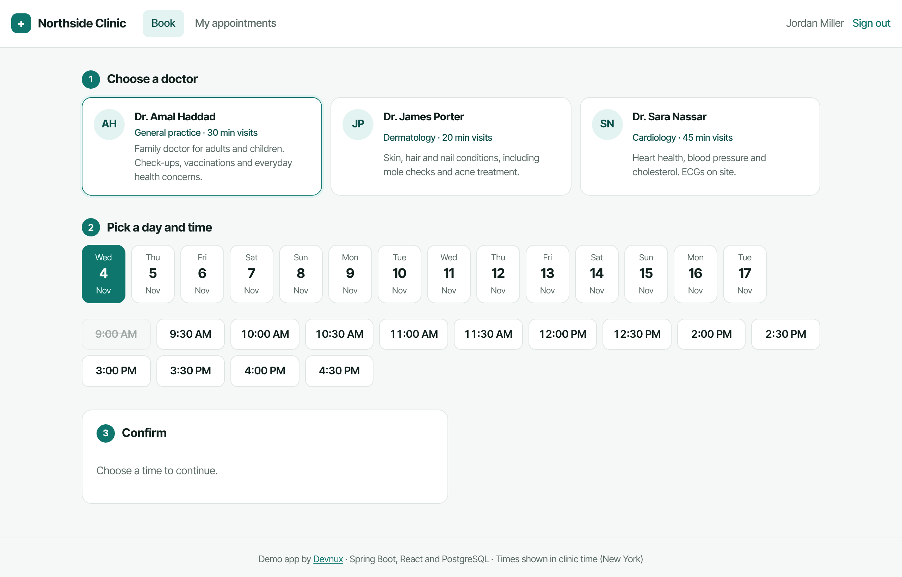
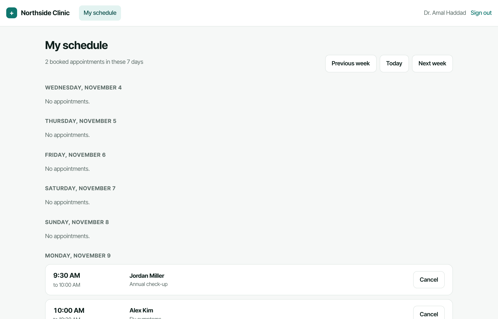
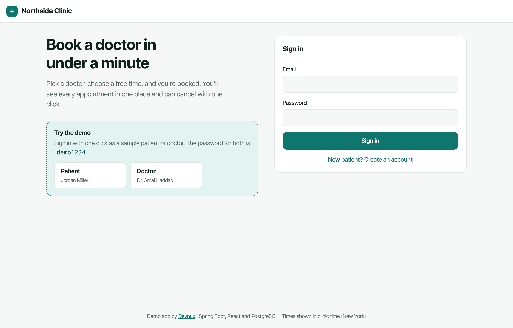

# Northside Clinic: appointment booking

A small, complete booking system for a medical clinic. Patients book visits online; doctors see and run their week. Built by [Devnux](https://devnux.tech) as a working demo.

**Stack**: Java 21 · Spring Boot 4 · Spring Security (JWT) · JPA · Flyway · PostgreSQL 16 · React 19 · TypeScript · Vite · Docker · Testcontainers



## What it shows

- **Double booking is impossible.** A PostgreSQL exclusion constraint on the doctor's time range rejects overlapping visits, even when several patients click "Confirm" at the same instant or the API runs on many servers. The API turns that into a friendly "Sorry, that slot was just booked by someone else". A test fires four simultaneous bookings and checks that exactly one wins.
- **Time zones done properly.** Visits are stored in UTC; working hours and slots are in the clinic's zone (`America/New_York` by default), so 9:00 AM stays 9:00 AM across daylight-saving changes.
- **Role-based access.** Patients see only their own visits; doctors see only their own schedule. Anything else returns 404, so ids can't be probed.
- **Spec-driven.** The feature was written with [Spec Kit](https://github.com/github/spec-kit): see the [constitution](.specify/memory/constitution.md), [spec](specs/001-clinic-booking/spec.md), [plan](specs/001-clinic-booking/plan.md), [data model](specs/001-clinic-booking/data-model.md), [API contract](specs/001-clinic-booking/contracts/api.md) and [tasks](specs/001-clinic-booking/tasks.md).

| Doctor's week | Sign in |
|---|---|
|  |  |

## Run it

You need Docker.

```bash
docker compose up --build
```

Open http://localhost:3000 and use the one-click demo sign-ins, or:

| Role | Email | Password |
|---|---|---|
| Patient | `patient@clinic.test` | `demo1234` |
| Doctor | `amal.haddad@clinic.test` | `demo1234` |

## Develop

```bash
# database only
docker compose up db -d

# API on :8080 (needs Java 21)
cd api && mvn spring-boot:run

# web on :5173, proxies /api to :8080
cd web && npm install && npm run dev
```

Tests start their own PostgreSQL with Testcontainers:

```bash
cd api && mvn verify
```

## Configuration

| Variable | Default | Meaning |
|---|---|---|
| `DATABASE_URL` | `jdbc:postgresql://localhost:5432/clinic` | JDBC URL (Cloud SQL and AlloyDB work unchanged) |
| `DATABASE_USER` / `DATABASE_PASSWORD` | `clinic` / `clinic` | Database login |
| `JWT_SECRET` | dev value | Signing key for sign-in tokens, 32+ characters. **Set this in production.** |
| `CLINIC_ZONE` | `America/New_York` | Clinic time zone |
| `CORS_ORIGINS` | `http://localhost:5173` | Allowed browser origins |
| `SEED_DEMO_DATA` | `true` | Create demo doctors, patients and visits on first start |

## API

See the [API contract](specs/001-clinic-booking/contracts/api.md). Errors follow RFC 9457 problem details.
